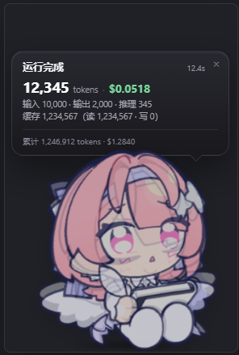
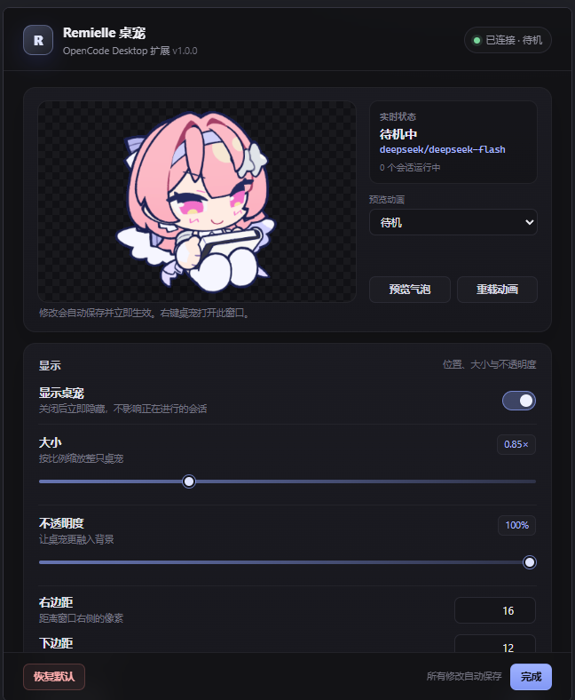

# Remielle 桌宠 · OpenCode Desktop 扩展

一个跟随 OpenCode Desktop 窗口的桌宠扩展。它会实时读取当前模型的运行状态，在右下角播放对应动画；每次运行结束后弹出气泡，显示本次消耗的 token 与费用。




## 功能

- **右下角悬浮**：透明无边框窗口，跟随 OpenCode 主窗口移动、缩放和最大化；与 OpenCode 处于同一层级，切换应用时不会被隐藏，但也不会盖在其他应用上层。
- **实时状态动画**
  - 没有任务：`待机.gif`
  - 模型开始工作：`思考.gif`
  - 模型调用工具：`拿笔待机.gif`
  - 模型操作文件：`间歇绘制.gif` / `连续绘制.gif`
  - 每次运行结束：`期待.gif`
  - 单击桌宠：`得意.gif`（可配置）
- **跟随对话框**：自动检测 OpenCode 的输入框位置，把桌宠放在输入框右侧；空间不足时自动换到左侧或上方。
- **自适应窗口**：无气泡时窗口只包住桌宠与状态胶囊；气泡出现时自动向上/向左扩展。
- **运行结束气泡**：显示本次 token（输入 / 输出 / 推理 / 缓存）、费用、耗时，以及可选的会话累计用量。
- **设置窗口**：右键桌宠显示齿轮按钮，再点击齿轮打开；大小、透明度、边距、气泡时长、绘制判定阈值、资源文件夹等，修改自动保存并立即生效。
- **资源热更新**：`res/` 是资源文件夹；设置里可切换目录、重新加载动画。
- **可逆安装**：扩展注册写入 OpenCode Desktop 的扩展表，安装/卸载前都会自动备份数据库。

## 环境

- OpenCode Desktop **V2**（本项目在 2.1.2 上开发）
- Node.js **22.14+**（安装器使用内置的 `node:sqlite` 与 `backup()`）
- Windows 10/11（主开发环境）；安装器也适配 macOS / Linux 的 OpenCode 数据目录

> 这是 OpenCode Desktop 的 **GUI 扩展**（`opencode.gui-extension/1`），不是服务端插件（`.opencode/plugins`），也不是 TUI 插件。桌宠需要真正的透明窗口和 GIF，因此使用桌面端的 GUI 扩展宿主。

## 安装

```powershell
cd C:\Users\username\remielle-opencode
node scripts/install.mjs
```

安装器会：

1. 构建 `dist/remielle-pet/`；
2. 把界面文件复制到 `%APPDATA%\ai.opencode.desktop\remielle-pet\`；
3. 把 `res/` 里的 GIF 复制为英文文件名到 `...\remielle-pet\assets\`；
4. 备份 `drafts.sqlite`，并写入 `remielle.pet` 扩展；
5. 提示你重启 OpenCode Desktop。

**必须完全退出 OpenCode Desktop 再重新启动**（托盘 / 任务栏退出，而不是只关窗口），扩展只会在启动时加载。

启动后桌宠会出现在窗口右下角。**右键桌宠 → 显示齿轮按钮 → 点击齿轮按钮**打开设置。

> 如果 OpenCode 正在运行，安装器仍可在 WAL 模式下安全写入，但当前进程不会热加载扩展。重启后生效。

## 卸载

```powershell
node scripts/uninstall.mjs          # 移除扩展注册，保留设置和资源
node scripts/uninstall.mjs --purge  # 同时删除运行时文件
```

数据库备份在 `%APPDATA%\ai.opencode.desktop\remielle-pet-backups\`。

## 资源文件

`res/` 中可以放中文文件名，安装器会自动映射：

| 状态 | 中文文件名 | 运行时英文名 |
| --- | --- | --- |
| 待机 | `待机.gif` | `idle.gif` |
| 拿笔待机 | `拿笔待机.gif` | `pen-idle.gif` |
| 思考 | `思考.gif` | `think.gif` |
| 间歇绘制 | `间歇绘制.gif` | `draw-intermittent.gif` |
| 连续绘制 | `连续绘制.gif` | `draw-continuous.gif` |
| 期待 | `期待.gif` | `expect.gif` |
| 得意 | `得意.gif` | `smug.gif` |

也支持直接使用英文文件名（如 `idle.gif`、`pen_idle.gif`）。启动时会检查源文件更新并自动复制；设置里「重载动画」可强制刷新。

## 状态判定

扩展订阅 OpenCode 的 `/api/event` 事件流，并读取会话用量：

| OpenCode 事件 / 数据 | 桌宠反应 |
| --- | --- |
| `session.execution.started` | 开始工作，进入思考 |
| `session.reasoning.started` / `reasoning.delta` | `思考.gif` |
| `session.tool.input.started` / `session.tool.called` | 根据工具名判断是否文件操作 |
| 文件工具命中（`read`、`write`、`edit` 等） | `间歇绘制.gif` |
| 时间窗口内文件操作达到阈值 | `连续绘制.gif` |
| `session.usage.updated` | 记录会话累计 token / 费用 |
| `session.execution.succeeded` / `failed` / `interrupted` | `期待.gif` + 气泡 |
| `session.idle` | 兜底结束本次运行 |
| 会话信息 `/api/session/{id}` | 获取模型名称、标题、累计 token 和费用 |

默认文件工具：`read, write, edit, patch, multiedit, apply_patch, create, delete, remove, move, rename, glob, grep, list, todowrite`。可在设置里增删（逗号分隔），例如把 `bash` 加进去，让所有 shell 操作也触发绘制。

## 设置项

| 设置 | 说明 |
| --- | --- |
| 显示桌宠 | 临时隐藏/显示 |
| 大小 | 0.6× – 1.8× |
| 不透明度 | 25% – 100% |
| 右边距 / 下边距 | 桌宠与输入框的横向间距 / 桌宠脚底相对输入框底部的偏移 |
| 显示状态胶囊 | 桌宠上方的小胶囊，显示模型与当前状态 |
| 单击桌宠 | 播放「得意」/ 打开设置 / 什么都不做；设置入口为右键显示齿轮后点击齿轮 |
| 运行结束气泡 | 是否显示 token 与费用气泡 |
| 气泡停留时间 | 2 – 30 秒 |
| 显示累计用量 | 气泡底部的会话累计 token 与费用 |
| 子会话也弹气泡 | 默认关闭，避免子智能体反复弹窗 |
| 完成动画时长 | 「期待」动画停留时间 |
| 绘制动画保持 | 文件操作后保持绘制姿势的时间 |
| 连续绘制阈值 / 统计窗口 | 窗口内多少次文件操作后进入连续绘制 |
| 文件操作工具 | 触发绘制动画的工具名列表 |
| 资源文件夹 | GIF 来源目录 |
| 调试日志 | 把事件写入 `remielle.log` |

## 目录结构

```text
remielle-opencode/
├─ res/                       # GIF 资源（源）
├─ manifest.json              # GUI 扩展清单
├─ docs/                      # README 截图
├─ src/
│  ├─ core.js                 # 纯状态机 + SSE 解析 + 用量格式化
│  ├─ main.js                 # 扩展主进程入口（窗口、SSE、配置、气泡）
│  ├─ renderer.js             # 清单要求的 renderer 占位入口
│  ├─ preload.js              # IPC 桥
│  └─ app/                    # 桌宠与设置界面（HTML/CSS/JS）
├─ scripts/
│  ├─ build.mjs               # 把 core.js 内联进 main.js
│  ├─ install.mjs             # 写入扩展数据库 + 运行时文件
│  ├─ uninstall.mjs           # 移除扩展
│  ├─ test-core.mjs           # 状态机单元测试
│  ├─ test-main.mjs           # Fake Electron + 本地 SSE 集成测试
│  └─ preview/                # 浏览器预览壳
└─ dist/                      # 构建产物（可重新生成）
```

## 开发与测试

```powershell
node scripts/test-core.mjs     # 状态机、SSE 解析、格式化
node scripts/test-main.mjs     # Fake Electron + 本地 SSE 全链路
node scripts/build.mjs
```

浏览器预览（不依赖 OpenCode）：

- `scripts/preview/pet.html`：288×431 的真实窗口尺寸，带演示状态循环。
- `scripts/preview/settings.html`：640×780 的设置窗口。

也可以直接打开 `src/app/pet.html?demo=1`（使用 `res/` 原始 GIF）。

## 工作原理（技术说明）

OpenCode Desktop 自带 GUI 扩展宿主，扩展清单格式为 `opencode.gui-extension/1`，扩展档案由 `manifest.json`、`main`、`renderer`、`style` 组成，存放在桌面端 `drafts.sqlite` 的 `extension` / `extension_file` 表。

在 packaged 构建中，官方的 `ExtensionInstall` / `ExtensionEnable` IPC 会返回 `unavailable`（`settings.guiExtensions` 页面也写着 *Development builds only*），但宿主启动时仍会加载数据库中已存在的扩展。因此安装器：

1. 备份 `drafts.sqlite`；
2. 直接写入 `extension` 与 `extension_file` 记录；
3. 把界面文件和资源放到 `userData/remielle-pet/`。

扩展主进程：

- 用 `BrowserWindow` 创建无边框、透明的桌宠窗口，并作为 OpenCode 主窗口的附属窗口（owner），与 OpenCode 共层级：位于 OpenCode 之上，但不会成为全局置顶；回到 OpenCode 时在普通窗口层内提升到主窗口上方，其他应用仍可正常覆盖它；
- 通过只读的 `executeJavaScript` 查询 OpenCode 渲染进程中的输入框（`textarea` / `contenteditable` / `textbox`）位置，把桌宠放在对话框右侧；空间不足时依次尝试左侧、上方；
- 窗口大小随状态自适应：待机时只保留桌宠 + 状态胶囊的空间，气泡出现时自动扩展；
- OpenCode 主题会把背景色应用到所有 `BrowserWindow`，扩展会拦截并持续把桌宠窗口背景重置为 `#00000000`，保证透明；
- 用 `screen.getCursorScreenPoint()` 轮询光标，动态切换 `setIgnoreMouseEvents`，让空白区域点击穿透、桌宠区域可交互；
- 通过 `ctx.serverEndpoints.get('sidecar')` 获取本地服务 URL 和 Basic Auth 头，订阅 `/api/event`；
- 运行结束时读取 `/api/session/{id}`，用会话累计值减去运行开始时的基线，得到本次 token / 费用；
- 气泡、设置窗口和桌宠通过 `preload` 暴露的最小 IPC 通信。

> 安装型扩展的 `main.js` 只能 `require` 清单 `imports.main` 中声明的模块。本项目声明了 `electron`、`node:fs`、`node:path`、`node:http`、`node:https`；新增依赖时必须同步修改 `manifest.json`，否则会在启动时报 `invalidModule`/模块名错误。

> 扩展主进程拥有与 OpenCode 主进程相同的权限。只安装你信任的扩展。

## 常见问题

**桌宠没有出现**

1. 确认已经完全退出并重启 OpenCode Desktop；
2. 打开 `%APPDATA%\ai.opencode.desktop\remielle-pet\remielle.log` 查看是否有 `starting Remielle`；
3. 如果日志里是 `pet.html is missing`，重新运行 `node scripts/install.mjs`；
4. 重新安装后仍然没有，检查 `drafts.sqlite` 是否包含 `remielle.pet` 记录（安装器输出会显示备份和写入结果）。

**桌宠在，但显示“未连接”**

扩展连不上本地 OpenCode 服务。设置 → 诊断 → 「测试服务器连接」查看结果；日志里会有 `connecting to OpenCode events`。通常重启 OpenCode 即可恢复。

**GIF 不显示 / 缺动画**

设置 → 资源 查看「x/7 个动画可用」。把缺的 GIF 放进资源文件夹，点「重载动画」。如果只有某个动画缺失，桌宠会回退到待机动画，不会消失。

**窗口是黑底而不是透明**

Windows 需要开启 DWM/硬件加速。如果系统禁用了透明效果，GIF 仍会显示，但背景可能不透明。可在 Windows 设置中开启「透明效果」。

**点击不到桌宠 / 右键没反应**

桌宠是透明置顶窗口，只有桌宠身体区域会接收鼠标事件。把光标移到桌宠身体上稍等片刻再右键，桌宠右下角会显示齿轮按钮；点击齿轮即可打开设置（8 秒内未点击会自动隐藏）。主进程每 60ms 根据光标位置切换鼠标穿透。

## 许可

仅用于个人学习与自用。GIF 素材版权归原作者所有；请勿将素材用于商业分发。
